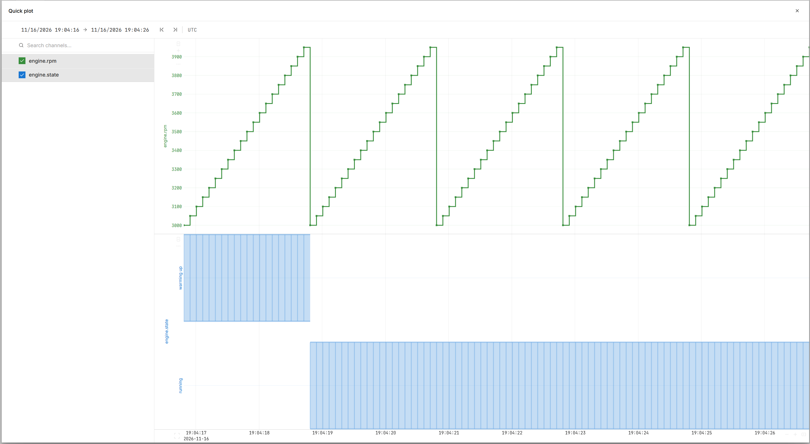

# Streaming

{.lead}
`nominal-streaming` sends data points to a Nominal dataset as your program produces them. It batches points in memory, applies backpressure when the network can't keep up, and can write to a file when requests fail. Use it from Rust, or from Python through the `nominal-streaming` package.

```{toctree}
:hidden:
:caption: Quickstart

Quickstart <self>
api-keys-setup
```

```{toctree}
:hidden:
:caption: Guides

guides/index
guides/configure
guides/write
guides/fallback
guides/files
guides/logs
```

```{toctree}
:hidden:
:caption: Examples

examples/index
examples/sensor-loop
examples/threads
examples/many-units
```

```{toctree}
:hidden:
:caption: Reference

ref/index
ref/rust/nominal_streaming/index
ref/python/nominal_streaming/index
```

This quickstart creates a dataset, streams 10 seconds of engine values to it, and opens the result in Nominal.

## 1. Install

::::{tab-set}
:sync-group: lang

:::{tab-item} Rust
:sync: rust

Use `cargo` to generate a new Rust project which uses `nominal` to create a dataset and `nominal-streaming` to stream your data to that dataset. The async calls in `nominal` require a `tokio` runtime.

```shell
cargo new streaming-quickstart
cd streaming-quickstart
cargo add nominal-streaming nominal
cargo add tokio --features full
```
:::

:::{tab-item} Python
:sync: python

With Python 3.11 or later, install `nominal` to create a dataset and `nominal-streaming` to stream your data to that dataset:

```shell
pip install nominal-streaming nominal
```

:::
::::

## 2. Set up your API key

Follow [API Keys Setup](api-keys-setup.md) to generate a profile for your `default` workspace and then create a second profile, `sandbox`, for your sandbox workspace. The code below is written against `sandbox`, but it can be changed to use any profile.

## 3. Stream values

This quickstart creates a new dataset and streams 10 seconds of data on two channels (`engine.rpm` and `engine.state`) to it.

::::{tab-set}
:sync-group: lang

:::{tab-item} Rust
:sync: rust

Replace `src/main.rs` with:

```rust
use std::time::{Duration, UNIX_EPOCH};

use nominal::core::DatasetCreate;
use nominal_streaming::prelude::*;
use nominal_streaming::stream::NominalDatasetStreamBuilder;

#[tokio::main]
async fn main() -> Result<(), Box<dyn std::error::Error>> {
    // Load the API key and base URL that API Keys Setup saved
    let config = nominal::Config::load()?;
    let profile = config.get_profile("sandbox").ok_or("no profile named sandbox")?;

    // Create the dataset to stream to
    let client = nominal::NominalClient::from_profile_config(profile)?;
    let created = client.catalog().create_dataset(DatasetCreate::new("Streaming quickstart")).await?;

    // Stream to the new dataset, saving points that can't be sent to a fallback file
    let token = BearerToken::new(profile.token())?;
    let dataset = ResourceIdentifier::new(created.rid())?;
    let stream = NominalDatasetStreamBuilder::new()
        .stream_to_core(token, dataset, tokio::runtime::Handle::current())
        .with_options(NominalStreamOpts::default().with_base_api_url(profile.base_url()))
        .with_file_fallback("fallback.avro")
        .try_build()?;

    // A writer for each channel, then 10 seconds of points on each, 100 ms apart
    let mut rpm = stream.double_writer(ChannelDescriptor::new("engine.rpm"));
    let mut state = stream.string_writer(ChannelDescriptor::new("engine.state"));
    let mut timestamp = UNIX_EPOCH.elapsed()?;
    for i in 0..100 {
        rpm.push(timestamp, 3000.0 + 50.0 * (i % 20) as f64);
        state.push(timestamp, if i < 20 { "warming up" } else { "running" });
        timestamp += Duration::from_millis(100);
    }

    // Writers pass their last points to the stream when dropped; dropping the stream
    // then waits until every point has been sent or saved to the fallback file
    drop(rpm);
    drop(state);
    drop(stream);

    // Print the link to the dataset in Nominal
    println!("{}", created.nominal_url());
    Ok(())
}
```

Run it with `cargo run`.
:::

:::{tab-item} Python
:sync: python

Save this as `quickstart.py`:

```python
import time
from pathlib import Path

from nominal.config import NominalConfig
from nominal.core import NominalClient
from nominal_streaming import NominalDatasetStream, PyNominalStreamOpts

# Load the API key and base URL that API Keys Setup saved
profile = NominalConfig.from_yaml().get_profile("sandbox")

# Create the dataset to stream to
client = NominalClient.from_token(profile.token, profile.base_url, workspace_rid=profile.workspace_rid)
dataset = client.create_dataset("Streaming quickstart")

# Stream to the new dataset, saving points that can't be sent to a fallback file
stream = (
    NominalDatasetStream(auth_header=profile.token, opts=PyNominalStreamOpts(base_api_url=profile.base_url))
    .with_core_consumer(dataset.rid)
    .with_file_fallback(Path("fallback.avro"))
)

# Leaving the block sends what's buffered and closes the stream
with stream:
    # 10 seconds of points on each channel, 100 ms apart
    timestamp = time.time_ns()
    for i in range(100):
        stream.enqueue("engine.rpm", timestamp, 3000.0 + 50.0 * (i % 20))
        stream.enqueue("engine.state", timestamp, "warming up" if i < 20 else "running")
        timestamp += 100_000_000

# Print the link to the dataset in Nominal
print(dataset.nominal_url)
```

Run it with `python quickstart.py`.
:::
::::

## 4. See the data

Open the printed link to view your dataset. You can then click **QUICK PLOT** to view the data.



## 5. Confirm no data was dropped

In environments where network connectivity is weak, the code will attempt to avoid losing data by writing to a fallback file.

::::{tab-set}
:sync-group: lang

:::{tab-item} Rust
:sync: rust

In Rust, this is enabled by adding `.with_file_fallback("fallback.avro")` to the StreamBuilder.

```rust
    let stream = NominalDatasetStreamBuilder::new()
        .stream_to_core(token, dataset, tokio::runtime::Handle::current())
        .with_options(NominalStreamOpts::default().with_base_api_url(profile.base_url()))
        .with_file_fallback("fallback.avro")
        .try_build()?;
```

:::

:::{tab-item} Python
:sync: python

In Python, this is enabled by adding `.with_file_fallback(Path("fallback.avro"))` to the Stream constructor call.

```python
stream = (
    NominalDatasetStream(auth_header=profile.token, opts=PyNominalStreamOpts(base_api_url=profile.base_url))
    .with_core_consumer(dataset.rid)
    .with_file_fallback(Path("fallback.avro"))
)
```

:::
::::

Under the hood, the code automatically adds a time suffix to the filename. That is, `fallback.avro` automatically becomes something like `fallback_20260101_120000.avro`.

This file is _only_ created if requests fail. If no file exists, your stream was successful. If you do see this file, you will want to upload it to the same dataset with nomctl or a Nominal client when connectivity is back. See [Upload a file to Nominal](guides/files.md#upload-a-file-to-nominal).

## Next

::::{grid} 1 1 2 2
:gutter: 3

:::{grid-item-card} Guides
:link: guides/index
:link-type: doc

Write each value type and tags, set batching and backpressure, handle errors, keep files of what you stream, and stream logs.
:::

:::{grid-item-card} Reference
:link: ref/index
:link-type: doc

The Rust crate and the Python package.
:::
::::
